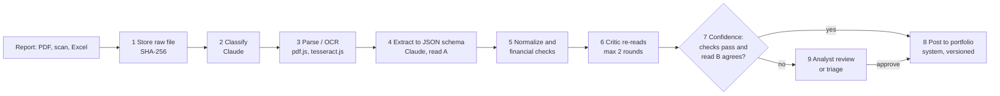

# GP Report Intelligence

A document-intelligence system for private equity fund reports, built from a case study I was given in a hiring
process. It reads GP quarterly reports (text PDFs, scans and Excel workbooks), checks the figures, and posts them to a
portfolio system only when two independent signals agree. Everything else goes to an analyst, with the reason.

**Live demo:** [gp-report-intelligence.netlify.app](https://gp-report-intelligence.netlify.app), no login. It shows
recorded runs of the real pipeline on synthetic reports; you can review a flagged report in your browser, and a reload
resets it. All fund data in this repository is synthetic.

## The problem
An investor in private equity funds receives quarterly reports from many general partners (GPs), each in its own
layout. Someone types the fund figures (NAV, paid-in capital, distributions, TVPI) and the portfolio companies into the
portfolio system by hand. That is slow, and one wrong figure is costly. The system has to take that work over without
ever posting a wrong key figure on its own, and it has to show why it trusted each figure it did post.

*The review screen on the public site: the NAV was read only from a chart, so the second read is not independent and
the report waits for an analyst. The visitor checks the value against the page, records it as a correction and
approves; the record is posted as version 1.*

## How it works
Each report goes through nine steps from my process sketch. Code receives and parses the file; Claude classifies it,
extracts the figures section by section into a JSON schema, and re-reads the source when a financial check fails.
Confidence is decided by code, per key figure, from two signals: do the financial identities hold (for example
TVPI = (distributions + NAV) / paid-in), and does a second, independent read of the page image give the same value?
Only if every key figure passes both is the report posted on its own. Otherwise an analyst sees the page next to the
figures and accepts, corrects or rejects them; reports from unknown GPs go to triage. The posting is append-only and
versioned, so a correction supersedes a record and never edits it. Logic lives in a pure `core/` with thin adapters
([ADR-0001](docs/adr/0001-pure-core-with-thin-adapters.md)); the database is reachable only from server functions
([ADR-0003](docs/adr/0003-server-only-data-access.md)).

Stack: Vite, React 19 and TypeScript (strict); Netlify Functions, with the pipeline in a background function
([ADR-0002](docs/adr/0002-background-functions-for-pipeline-runs.md)); Supabase Postgres and Storage behind deny-all
row security; Anthropic Claude (Opus 5.5 for every model step); pdf.js, @napi-rs/canvas and tesseract.js for rendering
and OCR ([ADR-0004](docs/adr/0004-page-rendering-and-ocr.md)). The public site reads a recorded snapshot and the live
functions need the owner's key ([ADR-0006](docs/adr/0006-public-snapshot-mode.md)).

## Eval results
Scores on the project's own golden set: 18 synthetic reports that I generated and labelled, split into 12 dev
documents and 6 held-out documents. The set is small and synthetic, so these numbers show that the checks work on the
cases it contains, not how the system would do on real reports. Graded by code, never by a model.

| pipeline@0.13.0 | dev split (n=12) | held-out split (n=6) |
|---|---|---|
| Unsafe auto-posts (a wrong key figure posted with no human) | 0 | 0 |
| Key-figure accuracy | 100.0% | 100.0% |
| All-figure accuracy | 99.6% | 100.0% |
| Classification accuracy | 100.0% | 100.0% |
| Route accuracy (auto-post, review or triage as labelled) | 91.7% (11 of 12) | 100.0% (6 of 6) |

- The held-out split did its job once. A switch to a cheaper model (Claude Sonnet 5.5) held every dev metric, then
  auto-posted a restated NAV on the held-out split (n=6, 1 unsafe auto-post). It was rolled back within minutes and the
  confidence rule was fixed ([error analysis](docs/error-analysis/2026-10-11-sonnet-restatement.md)). Because that fix
  was motivated by a held-out document, the held-out score above is no longer an unbiased measurement for it.
- The one dev routing miss (n=12) is conservative: a scanned report went to review instead of being posted.
- `npm run eval` replays recorded model answers for the dev split, at $0. CI runs it on every push and fails on any
  unsafe auto-post or on any metric below the committed [baseline](evals/baseline.json) (the
  [gate proof](docs/evals/gate-proof.md) shows a red run). `npm run eval:heldout` replays the held-out split.

## How it was built
I built it alone with Claude Code, following the [agent-skills](https://github.com/addyosmani/agent-skills) workflow:
a [capability map](CAPABILITY-MAP.md) of eight modules (a ninth, this public release, came later), then for each module a spec with decisions I approved
(for example [SPEC-confidence.md](SPEC-confidence.md)), a [plan with tasks](tasks/), a test-first build, a review and
an acceptance check against the spec's success criteria ([docs/acceptance/](docs/acceptance/)). Architecture decisions
are in [docs/adr/](docs/adr/); failures were traced to their first bad step in
[docs/error-analysis/](docs/error-analysis/); a [security audit](docs/security/) followed the build. CI runs typecheck,
lint, over 650 unit and integration tests, the build and the eval gate. The site's "How it works", "Tour", "Evals",
"Decisions" and "How it was built" pages present the same record in the app. This repository is a cleaned copy
published as one commit; the development history is kept in a private archive.

## Run it
Node 22 or later. `npm ci`, then:

| Command | What it does | Needs |
|---|---|---|
| `npm run dev` | the app, reading the committed snapshot (as the public site does) | nothing |
| `npm test` | unit and integration tests with coverage | nothing |
| `npm run typecheck`, `npm run lint`, `npm run build` | the other CI gates | nothing |
| `npm run eval`, `npm run eval:heldout` | the golden set replayed from recorded answers ($0) | nothing |
| `npm run test:e2e:snapshot` | browser tests on the static build: every page, a review that posts, no API call | Chromium |
| `netlify dev`, `npm run test:e2e` | app and functions together, and their browser tests | `.env` |
| `npm run snapshot` | re-export the public snapshot from the database (read-only) | `.env` |
| `npm run corpus:generate`, `corpus:verify` | the synthetic corpus and its labels | nothing |

The live functions need a Supabase project (`supabase/migrations/`, applied in order), an Anthropic API key and an
access key; copy `.env.example` to `.env`. Model spend is capped per day (`DAILY_LLM_BUDGET_USD`).

## What I would do next
- Close the remaining gap in the footnote rule: it only catches a restated figure when the second read prints the
  footnote marker. Then measure the cheaper model again, on new held-out reports.
- Grow the golden set, especially the held-out split, and add reports from layouts the generator does not produce.
- Upload files larger than 4 MB directly to storage with signed URLs; today a function receives the file, which caps
  its size.

## Licence
[MIT](LICENSE)
